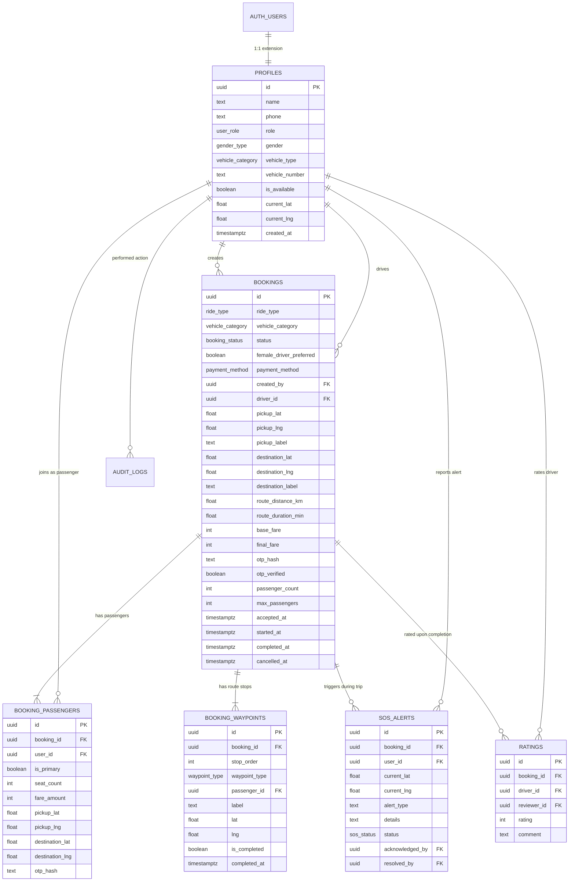

# GoShare — Database Relationship Model & Schema Reference

This directory contains the complete PostgreSQL database schema definition designed for **Supabase**.

## File Overview

- [`migration.sql`](file:///c:/Users/ayush/OneDrive/Desktop/pbl/goshare/database/migration.sql): Standalone, idempotent migration script that provisions all custom enum types, normalized tables, foreign keys, check constraints, indexes, Row Level Security (RLS) policies, and atomic RPC stored procedures.

---

## Entity Relationship Model (ERD)

---

## 1. Custom Enum Types
- `user_role`: `'user'`, `'driver'`, `'admin'`
- `vehicle_category`: `'rickshaw'`, `'mini'`, `'cab'`, `'suv'`
- `booking_status`: `'pending'`, `'accepted'`, `'in_progress'`, `'completed'`, `'cancelled'`
- `ride_type`: `'solo'`, `'shared'`
- `payment_method`: `'cash'`, `'upi'`
- `waypoint_type`: `'pickup'`, `'dropoff'`
- `sos_status`: `'active'`, `'acknowledged'`, `'resolved'`
- `gender_type`: `'male'`, `'female'`, `'other'`

---

## 2. Security & Row-Level Security (RLS)
The database enforces strict RLS policies to replace the legacy prototype's unauthenticated data access:

1. **`profiles`**:
   - Any authenticated user can read public profile data (name, vehicle info for drivers).
   - Users can only edit their own profile.
   - Users cannot arbitrarily elevate themselves to `'admin'` via direct UPDATE (enforced by SQL triggers).

2. **`bookings`**:
   - Passengers can only view bookings they created or are joined in.
   - Assigned drivers can view bookings assigned to them.
   - Drivers with matching vehicle categories can view `status = 'pending'` bookings in the request queue.
   - Admins can query all bookings across the platform.

3. **`sos_alerts`**:
   - Any authenticated user can INSERT an alert with their user ID.
   - Only admins can read all alerts and update the status to `'acknowledged'` or `'resolved'`.

4. **`ratings`**:
   - Passengers can only rate a booking they completed.
   - Drivers cannot rate themselves or alter passenger ratings.

---

## 3. Atomic RPC Stored Procedures
To prevent race conditions during concurrent driver accepts or shared pool joins, the migration provides stored SQL functions:
- `create_booking(...)`: Creates booking, inserts primary passenger, and seeds origin/destination waypoints in one atomic transaction.
- `join_shared_ride(...)`: Locks the booking row `FOR UPDATE`, checks capacity, verifies proximity, adds co-passenger, and updates pooled fare.
- `accept_booking(...)`: Concurrency-safe driver assignment ensuring no two drivers accept the same ride.
- `verify_otp_and_start(...)`: Cryptographically checks the passenger OTP and transitions ride state.
- `complete_waypoint(...)`: Advances the stop progression and marks the booking completed once all stops are serviced.
- `cancel_booking(...)`: Verifies cancellation authorization and resets driver availability.
